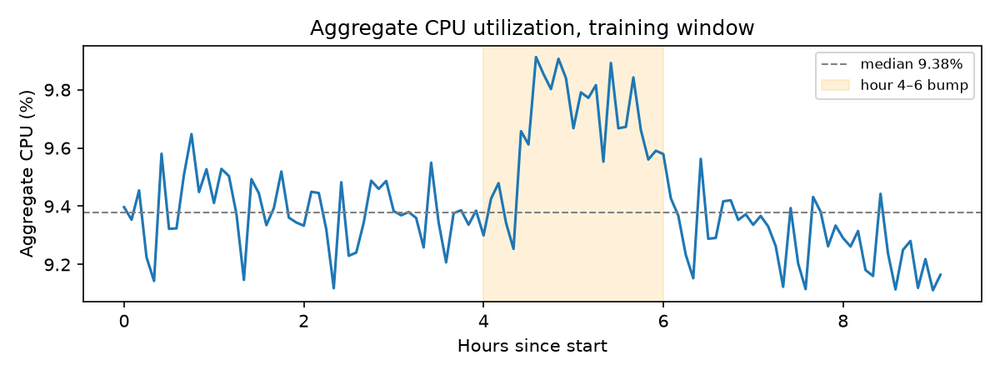
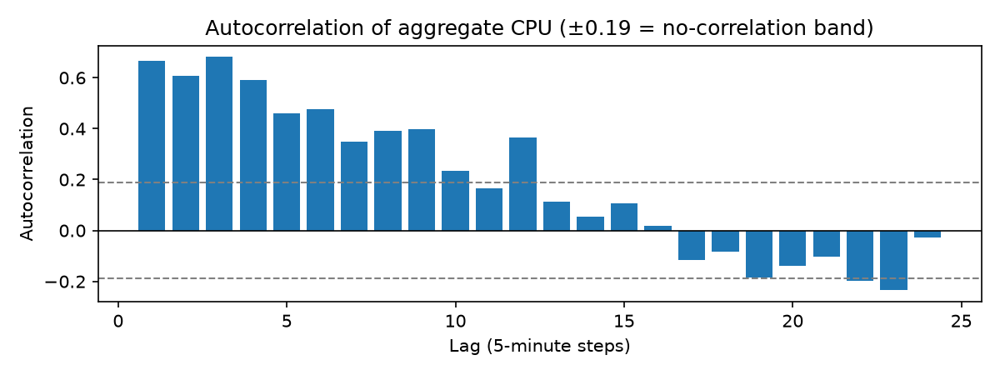
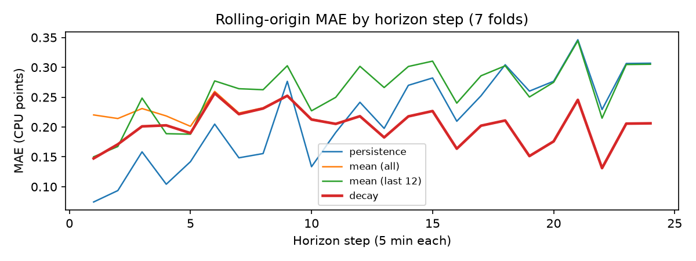
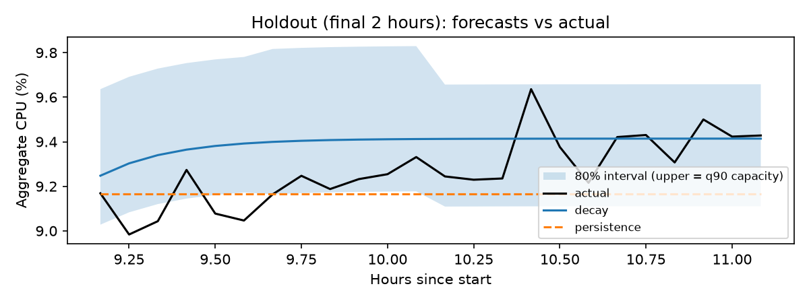

# Forecasting Cloud Workload Demand — Final Report

**Author:** Doğukan Ada Günter · AI/ML Engineering Intern take-home, Atomity · October 2026

## 1. Executive summary

- **The workload is stable but not easy to beat.** Aggregate CPU across 10,000 Azure VMs stays in a narrow band around 9.4% over the 9-hour training window, with no trend. The largest deviation is a ~0.5-point bump between hours 4 and 6, driven by a small group of VMs: the top 1% of VMs by increase account for about 78% of it.
- **`active_vm_count` is constant (10,000)** in this curated subset: no VM is created or deleted inside the window. It is forecast exactly; the interesting target is `aggregate_cpu_utilization`.
- **Model:** a simple *decay* forecast that starts at the last value and moves towards the training mean at the rate of the lag-1 autocorrelation. It combines the strengths of persistence (best at short horizons) and the mean (best beyond ~45 minutes).
- **Validation:** 7-fold rolling-origin evaluation inside the training window; the final 24 holdout values were looked at once, after the model was fixed. On the folds, decay has the lowest average error (MAE 0.201 vs 0.215 for persistence and 0.209 for the mean) and matches or beats the mean in all 7 folds; persistence still wins 4 of the 7 folds, so the margin is small. On the single holdout window persistence is slightly better (0.147 vs 0.154), a difference well within fold-to-fold variation.
- **Main failure mode:** during high-load periods decay pulls the forecast down towards the mean and under-predicts (fold MAE 0.330 vs 0.208 for persistence).
- **Recommendation:** provision **forecast + the q90 residual margin** (about 3–4% of the current level; under-provisioned in ~11% of 5-minute steps on the folds, never on the holdout), use a more conservative q95 margin for latency-sensitive Interactive workloads, and add a **peak-risk trigger**: when the latest value is above the forecast, base capacity on the latest value.

## 2. Data understanding and preprocessing

**Audit** (`notebooks/01_data_audit.ipynb`):

| Check | Result |
|---|---|
| Missing values | none in either file |
| Timestamps | 134, from 0 to 39,900 s, every step exactly 300 s |
| VMs | 10,000; the same set in readings and metadata; 134 readings each |
| Duplicate `(timestamp, vm_id)` | 0 |
| CPU columns | all in [0, 100]; min ≤ avg ≤ max on every row |
| VM lifetimes | all `timestamp_vm_created` = 0; earliest deletion 40,500 s, after the last reading (39,900 s); 82% live until the end of the ~30-day trace |

The data is clean and regular, so no resampling or gap filling is needed. It is also **curated**: every VM exists for the whole window. This removes churn and is a form of selection bias — the capacity findings describe a stable population of long-lived VMs, not a fleet with arrivals and departures.

**Target construction** (`src/cwfc/targets.py`, `build_targets`):

- A reading is **valid** if `timestamp`, `vm_id` and `avg_cpu` are present and `avg_cpu` is in [0, 100]. Invalid rows are dropped, never imputed: filling a missing reading would change the definition of "VMs with a valid reading". The number of dropped rows is logged (0 on this data).
- Per timestamp: `active_vm_count` = number of distinct VMs with a valid reading; `aggregate_cpu_utilization` = mean `avg_cpu` of those VMs. A VM without a reading at a timestamp simply drops out of that timestamp, so churn (deletions or new VMs) needs no special rule.
- Missing required columns raise an error instead of silently producing a wrong table.
- The full target series is built first and then split. This is not leakage: each value uses only the rows of its own timestamp.

**Time representation.** Timestamps are seconds since the trace start; the wall-clock time of 0 is unknown. No calendar (hour-of-day) features are used: the hour would rest on an unknown offset, and the 11-hour window covers less than half a day, so a daily pattern cannot be learned from it. Raw timestamps are kept for `predictions.csv`.

**Leakage protection.** `src/cwfc/split.py` (`split_holdout`) is the only code that touches the holdout. It returns the training rows and the holdout **timestamps only**, never their target values, and refuses tables that are too short or not sorted. Metadata columns `max_cpu`, `avg_cpu` and `p95_max_cpu` summarise each VM's 30-day life, which includes the holdout window, so they are not used as features.

## 3. Workload analysis

All analysis uses the training window only (`notebooks/02_eda.ipynb`).

- **Level and trend.** Median 9.38%, no visible trend. The largest deviation peaks at 9.91% at hour 4.6, about 0.53 points (~6%) above the median. A slow rise precedes it, but the jump itself is abrupt.
- **Who drives the bump.** Comparing each VM's mean CPU inside and outside hours 4–6, the 10 VMs with the largest increase (0.1%) account for ~14% of the increase and the top 100 (1%) for ~78%. Bursts from a few workloads give only a weak early signal in the aggregate history.
- **Per-VM utilization is highly skewed.** Median VM 5.5%, 90% of VMs below 19.7%, top 1% at ~99%; only 2.2% average above 50%. The aggregate mean (9.4%) does not describe a typical VM. Most VMs look heavily over-provisioned (a right-sizing opportunity), while capacity risk is concentrated in a small group of near-saturated VMs. CPU is only one dimension: a VM's size may be set by memory.
- **Segments** (`vm_category`):

| Category | VMs | Mean CPU | Std | First → last hour | Peak hour | Correlation with aggregate |
|---|---|---|---|---|---|---|
| Delay-insensitive | 6,180 | 8.26% | 0.22 | 8.19 → 8.10 | 5.2 | 0.93 |
| Interactive | 3,091 | 11.51% | 0.24 | 11.44 → 11.37 | 5.4 | 0.77 |
| Unknown | 729 | 10.35% | 0.63 | 11.14 → 9.57 | 1.4 | 0.25 |

  The bump appears in Interactive and Delay-insensitive at the same time but not in Unknown, which is three times more volatile and is the only segment with a downward trend. The aggregate mostly follows Delay-insensitive (62% of VMs) and hides these differences.
- **Step-to-step changes** are small: std 0.16 points (~1.7% of the level), largest single rise 0.44 points. The risk for a 2-hour forecast comes from small changes accumulating, not from single jumps.
- **Autocorrelation** is ~0.7 at lag 1 and declines gradually, falling inside the ±0.19 no-correlation band from about lag 15 (75 minutes).

This last point shapes the forecasting approach: recent values carry information for the next few steps but almost none for two hours ahead.

## 4. Forecasting approach

Three baselines and one model, all with the same interface (`src/cwfc/baselines.py`):

- **Persistence:** repeat the last training value.
- **Mean:** repeat the mean of the training window (also tested on the last 12 points only).
- **Decay (final model):**

  forecast(h) = mean + (last − mean) × φ^h, h = 1 … 24

  where φ is the lag-1 autocorrelation of the data the forecaster is given. At h = 1 the forecast is close to the last value; as h grows it converges to the mean. φ is estimated inside each fold, not once on the full training window, to avoid leaking validation data into the folds. If φ is undefined (constant series) or negative, it is set to 0 and the forecast is the mean.

The same model forecasts both targets. For `active_vm_count` the series is constant, so the forecast is exactly 10,000; counts are clipped at 0 and rounded to whole VMs. CPU forecasts are clipped to [0, 100].

A more complex model was not pursued: the series is nearly flat, its largest movements come from a few VMs whose bursts are not visible in the aggregate history, and the assignment does not reward complexity on its own.

## 5. Validation methodology

- **Rolling-origin evaluation** inside the 110-step training window (`src/cwfc/evaluation.py`, `backtest`): minimum training size 50, step 6, horizon 24 → **7 folds** whose 24-step validation windows cover steps 50–73 up to 86–109, so the last fold ends exactly at the end of the training window and the first one covers the hour 4–6 bump.
- **Why these values:** the goal is to mimic the final setting (110 training points → 24 steps ahead). A minimum of 50 points (4 h 10 min) is about half the final training size: short enough to give several folds, long enough for a stable mean and a meaningful φ. Much smaller values (e.g. 20) give unrealistically short histories and pessimistic scores; much larger ones leave a single, noisy fold.
- **Starter-code trap:** the provided `rolling_origin_splits` defaults to a 1-day horizon and 7-day minimum training size; on this 110-point series it silently returns an empty list. All parameters are passed explicitly, `backtest` raises an error when there are no folds, and a test documents the trap.
- **Holdout:** the final 24 observations were used once, after the model, the validation settings and the interval method were fixed (`notebooks/04_holdout_evaluation.ipynb`). Nothing was tuned afterwards.
- **Tests** (`tests/`, 23 tests): target construction, invalid rows, missing columns, holdout split guards, fold counts, baseline edge cases (constant and negatively autocorrelated series), interval alignment, and an end-to-end smoke test of the CLI on a tiny dataset with churn, a missing value and an out-of-range value.

## 6. Results versus baseline

**Rolling-origin folds** (aggregate CPU, 7 × 24 forecasts, `notebooks/03_baselines.ipynb`):

| Model | MAE | Fold std | RMSE | vs persistence (MAE) |
|---|---|---|---|---|
| decay | **0.201** | 0.060 | **0.230** | +6.5% |
| mean (all) | 0.209 | 0.056 | 0.238 | +3.0% |
| persistence | 0.215 | 0.096 | 0.251 | — |
| mean (last 12) | 0.260 | 0.100 | 0.288 | −20.6% |

The gain is small relative to fold-to-fold variation, but consistent: decay matches or beats the mean in all 7 folds.

By horizon, persistence is far better at step 1 (MAE 0.074) but degrades to 0.307 by step 24; the mean is roughly flat and overtakes persistence at step 9 (45 minutes), as the autocorrelation analysis predicted. Decay follows persistence's shape early and the mean's late.

**Holdout** (single 24-step window):

| Model | MAE | RMSE | Bias (actual − forecast) | vs persistence |
|---|---|---|---|---|
| persistence | **0.147** | 0.185 | +0.104 | — |
| decay | 0.154 | **0.184** | −0.124 | −4.8% |
| mean (all) | 0.175 | 0.210 | −0.145 | −18.9% |

The holdout is one window, i.e. one fold; a 0.007 MAE difference is well inside the fold std of ~0.06, and persistence also won 4 of the 7 validation folds. The model choice rests on the 7 folds and was not changed after seeing the holdout.

**`active_vm_count`:** all methods are exact (MAE 0) on folds and holdout. A relative metric against persistence is undefined here because the baseline error is 0; no percentage metric (e.g. MAPE) is used, so near-zero denominators do not arise for CPU either, whose level is ~9%.

## 7. Error and failure analysis

- **High-load periods (main failure mode).** In the top quarter of actual load across the folds, decay's MAE is 0.330 against 0.208 for persistence (rest of the time: 0.158 vs 0.218). When demand is elevated, decay pulls the forecast down towards the long-run mean and under-predicts — exactly when capacity matters most. This follows from the workload analysis: peaks come from a few bursting VMs, and the mean assumes they will fade.
- **First step.** At h = 1 decay is worse than persistence (0.147 vs 0.074): it already moves 30% towards the mean, while the local level can differ from the long-run mean.
- **Holdout bias.** On the holdout decay over-forecasts (bias −0.124): the holdout level (9.27%) is below the training mean (9.41%) and closer to the last training value (9.17%). Its largest errors come from a dip at steps 2–6 (actual ~9.0–9.1%); in the highest quarter of holdout values its MAE is 0.059. The direction of the error therefore depends on the window: mostly under-forecasting on the folds, over-forecasting on the holdout.
- **Intervals.** An empirical 80% interval is built from the decay residuals on the folds, pooled in horizon bands 1–6, 7–12 and 13–24 (`src/cwfc/interval.py`) because each single step has only 7 residuals. On the folds the residuals are skewed upwards (band 1–6: [−0.22, +0.39]), consistent with under-predicted bursts. On the holdout the interval covers 79.2% of values; all 5 misses fall below the lower bound and the upper bound is never exceeded.
- **Hidden segment behaviour.** The aggregate hides Unknown's downward drift and the segment-specific timing of the bump; a forecast on the aggregate reacts late to changes that start in one segment.

## 8. Capacity-planning recommendation

**Policy:** provisioned capacity = forecast + margin, where the margin is a quantile of the decay residuals per horizon band (`notebooks/05_capacity.ipynb`).

| Margin | Under-provisioned steps (folds) | Idle headroom (folds) | Under-provisioned (holdout) | Idle headroom (holdout) |
|---|---|---|---|---|
| none | 36.9% | 0.01 | 25.0% | 0.12 |
| q80 | 20.8% | 0.23 | 4.2% | 0.35 |
| **q90** | **11.3%** | **0.33** | **0.0%** | **0.45** |
| q95 | 6.5% | 0.42 | 0.0% | 0.54 |

Headroom is in CPU points; fold rates are in-sample for the margin and therefore optimistic, which is why the holdout columns are shown as an independent check.

- **Default: q90** (0.39 / 0.42 / 0.24 points for steps 1–6 / 7–12 / 13–24, i.e. about 3–4% of the current level). Beyond q90 each extra unit of headroom buys much less risk reduction (q80 → q90 removes 9.5 points of risk for 0.10 headroom; q90 → q95 removes 4.8 points for 0.09), because only the rarest, largest surprises are left.
- **Interactive workloads: q95.** They are latency-sensitive and cannot be postponed, so the cost of under-provisioning is higher.
- **Peak-risk trigger:** when the latest observed value is above the decay forecast, use the latest value as the base for the next steps. This targets the failure mode above, where decay under-predicts during high load. It is proposed from the fold analysis and has not been evaluated on the holdout.
- **Shift deferrable work:** the bump also appears in Delay-insensitive workloads; moving part of that work out of peak periods (load shifting) lowers the peak the capacity must cover.
- **Right-sizing:** with a median VM at 5.5% CPU, reviewing VM sizes (CPU together with memory) is likely to save more than fine-tuning the cluster margin.

The trade-off: under-provisioning risks slow or failed requests and SLA penalties, mostly for Interactive services; over-provisioning costs money continuously. The q90 margin accepts occasional short shortfalls in exchange for a small, steady buffer.

## 9. Limitations and future work

- **Short history.** 9 hours of training data: no daily or weekly seasonality can be learned, and the wall-clock time is unknown. With weeks of data, seasonal baselines and calendar features would be the first additions.
- **Curated, churn-free population.** All VMs live through the window, so `active_vm_count` is trivial and capacity effects of arrivals and departures are not represented.
- **Single holdout window.** Holdout results are one sample; conclusions rest on the 7 folds, which overlap and are not independent, so the interval coverage is approximate.
- **Aggregate-only forecasting.** Segment-level forecasts (especially for Unknown and Interactive), a burst detector based on the few high-impact VMs, and evaluating the peak-risk trigger on more data are natural next steps.
- **CPU only.** Memory and core counts would make capacity recommendations concrete in cores or VM sizes (e.g. core-weighted utilization).
